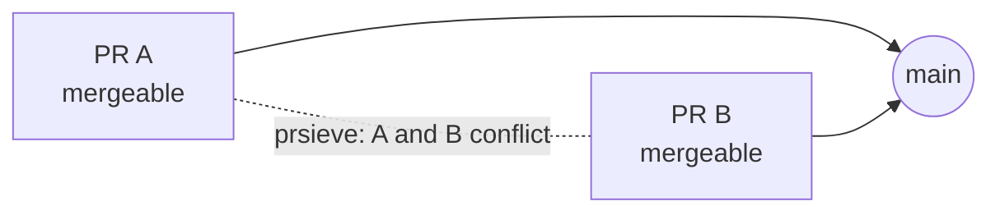

# prsieve

[](https://github.com/kirtanbhatt10/prsieve/actions/workflows/ci.yml)
[](LICENSE)


**Triage pull requests before you spend review time on them.**

Two pull requests arrive on the same afternoon. Both are green. Both say "no conflicts
with base branch". You merge the first, and the second one turns red.

That is not a hypothetical. It is what happened on
[trustgate](https://github.com/kirtanbhatt10/trustgate) the day this tool was written, and
prsieve finds it from the two branches alone:

```console
$ prsieve queue --base e09e469 --pr '#19=refs/pr/19' --pr '#20=refs/pr/20'
prsieve 0.1.0  2 open pull requests against e09e469

MEDIUM  PS100  #19 README.md
        Conflicts with #20: both change the same part of this file. Whichever merges second will need a rebase.

Pick an order: #19 and #20 conflict; the second one needs a rebase
1 finding: 1 medium
```

It also shows why they collided. One of the two was a documentation change that
re-formatted every table in the README on the way:

```console
$ prsieve check --base e09e469 --head '#20=refs/pr/20' --other '#19=refs/pr/19'
MEDIUM  PS200  README.md
        85 of 86 changed lines are formatting only (whitespace, quotes, table padding or moved lines); 1 line carries a real change.
```

Both were good contributions. The maintainer just had no way to see the collision until
after the first merge. ([Reproduce it yourself](#reproduce-the-example).)

## What it answers

GitHub checks each pull request against the base branch. prsieve checks the things a
maintainer has to work out by hand:



| Question | Rules |
| --- | --- |
| Will these open pull requests collide with each other? | PS100, PS101, PS102 |
| How much of this diff is a real change, and how much is formatting? | PS200 |
| Does the description match the diff? | PS300, PS301, PS302, PS303 |
| Does it touch CI, actions or CODEOWNERS? Is it too big to review? | PS400, PS500 |

- **Deterministic.** No model, no scoring, no network calls to a review service. The same
  commits and the same description always give the same findings.
- **Zero dependencies.** Python 3.10+ standard library and the `git` you already have.
- **Never runs pull request code.** It reads diffs and asks git for trial merges. Nothing
  is checked out, installed, built or executed.
- **Built for CI.** Text, JSON, Markdown and GitHub annotation output, a GitHub Action,
  and exit codes you can gate on.

## Install

```bash
pipx install git+https://github.com/kirtanbhatt10/prsieve@v0.1.0
# or run it once without installing:
uvx --from git+https://github.com/kirtanbhatt10/prsieve@v0.1.0 prsieve --version
# or straight from a checkout:
git clone https://github.com/kirtanbhatt10/prsieve && cd prsieve && python -m prsieve --version
```

prsieve is not published on PyPI. Install it from this repository.

Requirements: Python 3.10 or newer and git 2.38 or newer.

## Use it as a GitHub Action

```yaml
name: prsieve
on: [pull_request]
permissions:
  contents: read
  pull-requests: read
jobs:
  triage:
    runs-on: ubuntu-latest
    steps:
      - uses: actions/checkout@v5
      - uses: kirtanbhatt10/prsieve@v0.1.0
```

Each finding becomes an annotation, and the job summary gets a table. By default the step
fails only on `high` findings (a "docs only" pull request that changes code), so
collisions and churn are reported without blocking anyone.

| Input | Default | Meaning |
| --- | --- | --- |
| `fail-on` | `high` | fail at or above this severity: `info`, `low`, `medium`, `high` or `none` |
| `min-severity` | `info` | hide findings below this severity |
| `ignore` | | rule ids to skip, space or comma separated |
| `max-others` | `30` | compare with at most this many other open pull requests |
| `annotations` | `true` | annotate findings on the pull request |
| `job-summary` | `true` | write a Markdown table to the job summary |
| `token` | `github.token` | token used to list open pull requests; read access is enough |

Output: `findings`, the number of findings reported.

The action fetches the base branch and the other pull request heads itself, so the default
shallow checkout is fine. Keep the default `persist-credentials` on `actions/checkout` for
private repositories, because that fetch uses the checkout's credentials.

## Use it from the command line

On a clone of a GitHub repository:

```bash
prsieve github --slug OWNER/REPO --pr 20     # triage one pull request
prsieve github --slug OWNER/REPO --all       # the whole open queue, with a merge order
```

Set `GITHUB_TOKEN` (or `GH_TOKEN`) for private repositories and higher rate limits.

Without GitHub, on any branches or commits you already have:

```bash
prsieve check --base origin/main --head feature-a --other feature-b --other feature-c
prsieve check --base origin/main --head feature-a --title "docs: fix typo" --body-file pr.md
prsieve queue --base origin/main --pr feature-a --pr feature-b --pr feature-c
prsieve rules            # list every rule
prsieve rules PS100      # explain one rule and what to do about it
```

`NAME=REF` gives a branch a display name: `--head '#20=refs/pr/20'`.

| Option | Default | Meaning |
| --- | --- | --- |
| `-C, --repo PATH` | `.` | git repository to read |
| `-f, --format` | `text` | `text`, `json`, `markdown` or `github` (Actions annotations) |
| `-o, --output FILE` | stdout | write the report to a file |
| `--summary FILE` | | also append a Markdown report to a file |
| `--json FILE` | | also write a JSON report to a file |
| `--fail-on LEVEL` | `high` | exit 1 if any finding is at or above `LEVEL`; `none` never fails |
| `--min-severity LEVEL` | `info` | hide findings below `LEVEL` |
| `--ignore RULE` | | skip a rule id (repeatable) |
| `--no-color` | | plain output (`NO_COLOR` is respected too) |

Exit codes: `0` nothing at or above `--fail-on`, `1` findings, `2` usage or git error.

## Rules

| Rule | Name | Severity | What it means |
| --- | --- | --- | --- |
| PS100 | conflicts-with-open-pr | medium | This pull request and another open one cannot both merge as they stand. |
| PS101 | shares-files-with-open-pr | info | Another open pull request edits the same files, but the two merge cleanly. |
| PS102 | conflicts-with-base | medium | The branch no longer merges cleanly into its base branch. |
| PS200 | formatting-churn | medium | Most changed lines in a file are re-formatted or moved, not changed. |
| PS300 | docs-only-claim | high | The pull request says it is documentation only but changes other files. |
| PS301 | no-dependency-claim | medium | The pull request says it adds no dependencies but edits a dependency manifest. |
| PS302 | test-count-claim | low | The description promises more new tests than the diff adds. |
| PS303 | unchecked-checklist | info | The description still has unchecked checklist items. |
| PS400 | changes-automation | medium | The pull request changes CI, action or ownership files. |
| PS500 | oversized | low | The pull request is larger than most reviewers can check carefully. |

Details, thresholds and what to do about each one: [docs/rules.md](docs/rules.md).

## How it works

- **Collisions** are found with `git merge-tree --write-tree`, the same three-way merge
  git would do, run in memory for each pair of pull requests that touch a common file. A
  conflict is only blamed on the pair when both pull requests changed the conflicted file.
- **Churn** compares the removed and added lines of each modified file after removing
  whitespace, unifying quotes and dropping trailing commas. Lines that match are
  formatting or moves, not changes.
- **Claims** are plain pattern matches on the title and description, checked against the
  list of changed files. Text inside HTML comments and unchecked checklist items is not
  treated as a claim.

## Design notes

- **No repository-controlled config.** prsieve reads no settings from the repository it
  inspects, so a pull request cannot switch its own checks off. Configure it in the
  workflow or on the command line.
- **What it writes.** `prsieve github` fetches into `refs/prsieve/` in your clone, and
  trial merges add loose objects to the object store. The work tree, the index and your
  branches are never touched.
- **Network.** Only `prsieve github` uses the network: the GitHub REST API over HTTPS to
  list pull requests, and `git fetch`. `check`, `queue` and `rules` are offline.
- **Safe to print.** Titles, branch names and paths come from pull request authors.
  Control characters, bidirectional overrides and zero-width characters are shown as
  `\uXXXX`, and annotation and Markdown output is escaped.

## Limits

- PS100 means the two branches conflict as text. Two pull requests can merge cleanly and
  still break each other; PS101 points you at those pairs but cannot judge them.
- The claim rules are heuristics over English descriptions. They are prompts to look, and
  the test-count rule in particular only recognises common test frameworks.
- One page of open pull requests (the 100 most recently updated) is read, and by default
  the 30 most recent are compared.
- Tested on Linux and macOS. Windows is not tested yet.

## Reproduce the example

```bash
git clone https://github.com/kirtanbhatt10/trustgate && cd trustgate
git fetch origin +refs/pull/19/head:refs/pr/19 +refs/pull/20/head:refs/pr/20
prsieve queue --base e09e469 --pr '#19=refs/pr/19' --pr '#20=refs/pr/20'
```

`e09e469` is the commit `main` pointed at while both pull requests were open.

## Related tools

- [trustgate](https://github.com/kirtanbhatt10/trustgate): see everything a repository will run before you trust it
- [runnerguard](https://github.com/kirtanbhatt10/runnerguard): GitHub Actions workflow linting
- [mcp-warden](https://github.com/kirtanbhatt10/mcp-warden): audit of MCP server configs

## Contributing

Bug reports, false positives and new rules are welcome. Start with
[CONTRIBUTING.md](CONTRIBUTING.md). Security issues: [SECURITY.md](SECURITY.md).

## License

MIT (c) 2026 Kirtan Bhatt
